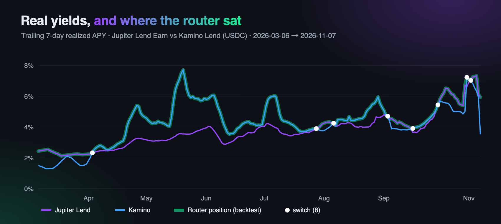
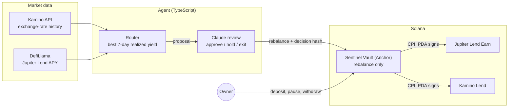
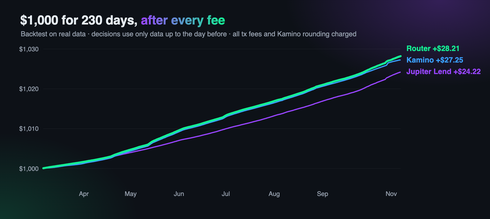

<div align="center">


**An autonomous AI agent that earns stablecoin yield on Solana,<br>inside a vault that only lets it move your USDC between whitelisted lending pools.**

[](https://solscan.io/tx/3aLHForFJLv1rxt2MgdSztgqLNh9coqvtDeBuyEPvxGptb4xUs1tiscsLbSBKMmQm9bcYn3FD8AFRWzTRu1UuDVr)
[](programs/sentinel_vault)
[](agent/src)
[](agent/src/yield-brain.ts)
[](https://www.mlh.com/events/solana-hackathon)

[Demo video](https://youtu.be/MP8hbujpc8g) · [How it works](#how-it-works) · [Results](#results) · [Quick start](#quick-start) · [Full write-up](SUBMISSION.md)

</div>

---

## Why SolSentinel

Idle USDC earns nothing, and handing an AI agent your wallet is a leap of faith. SolSentinel splits the job in two:

- **The agent decides.** A deterministic router picks the lending pool with the best realized yield, and Claude reviews every move.
- **The program enforces.** An Anchor program holds the funds. The agent key can call exactly one instruction, `rebalance`, and only between whitelisted pools inside the vault's own accounts.

A compromised or prompt-injected agent can, at worst, move your USDC from one whitelisted lending pool to another.

## Highlights

- 🛡️ **On-chain guardrails.** Program whitelist, vault-only token accounts, measured `max_in` / `min_out`, rate limits, owner-only withdrawals.
- 🤖 **Rule proposes, AI reviews.** Claude can approve, hold, or pull everything back to idle USDC. It can never choose a destination the router didn't propose.
- 📈 **Profitable after every fee.** 4.51% net APY over 230 days of real data, ahead of holding either pool.
- 🧪 **Tested against the real protocols.** 11 tests on a local mainnet fork with the production Jupiter Lend and Kamino programs.
- 🔍 **Auditable decisions.** Every decision is hashed (sha256), and the hash goes on-chain in the same transaction as the move.
- 💸 **Live with real money.** Running on Solana mainnet since 2026-11-07.

## Demo

<div align="center">
<a href="https://youtu.be/MP8hbujpc8g"></a>
<br><sub>▶ <a href="https://youtu.be/MP8hbujpc8g">Watch the demo video on YouTube</a></sub>
</div>

## How it works



1. **Value.** The agent values the vault on-chain: Jupiter Lend via `convertToAssets`, Kamino via reserve supply ÷ collateral mint supply.
2. **Propose.** The router holds the venue with the best trailing 7-day *realized* yield. It switches only if 14 days of extra yield pays for both transactions.
3. **Review.** Claude reviews the proposal through structured outputs (Zod schema → `messages.parse`). Without an API key, or on any error, the rule's proposal stands.
4. **Execute.** The `rebalance` transaction carries the decision hash. Holds are journaled off-chain only, because writing every hold on-chain would cost more than a small vault earns.

### What the vault enforces

| Guardrail | Enforced by `sentinel_vault` |
|---|---|
| Program whitelist | The CPI target must be a whitelisted (lending program, receipt mint) pair, signed by the vault PDA. |
| Funds stay inside | Tokens move only between the vault's USDC account and its receipt-token account for that venue (jlUSDC or Kamino cToken). |
| Honest amounts | `max_in` and `min_out` are checked against measured balance deltas, so the agent cannot misreport fills. |
| Rate limits | Moves per day and the minimum interval between moves are capped, so a hijacked agent cannot burn fees by churning. |
| Kill switch | The owner can pause deposits. Withdrawals back to USDC always work. |
| Custody | Only the owner can withdraw. Every account can be closed for a full rent refund. |

## Results

### Backtest: profitable after every fee



Real data for the two exact venues the vault integrates, 2026-02-27 → 2026-11-07 (230 days). Kamino's return is realized from its on-chain collateral exchange rate. Jupiter Lend uses its daily base APY, with rewards not counted. Decisions use only data up to the day before. Every cost is charged: setup, first deposit, 2 transactions per switch, closing transactions and Kamino rounding.

| Vault size | Router net APY | Jupiter Lend only | Kamino only |
|---:|---:|---:|---:|
| $10 | **4.10%** | 3.72% | 4.20% |
| $100 | **4.47%** | 3.86% | 4.35% |
| $1,000 | **4.51%** | 3.87% | 4.36% |

All 200 rolling 30-day windows were positive. At $10, fixed fees eat most of the routing edge; from $100 up, the router beats both pools. Reproduce with [`research/yield/router2.py`](research/yield/router2.py) (output in [`router2.out`](research/yield/router2.out)).

### Live on mainnet

To keep the experiment under $10, the vault program (about 1.9 SOL of rent) is not deployed on mainnet. The agent wallet runs in **direct mode** with the same guardrails, checked by simulating each transaction before sending it: program whitelist, `max_in` / `min_out`, and rate limits. The decision hash goes into an SPL Memo in the same transaction.

| | |
|---|---|
| Started | 2026-11-07 16:31 UTC |
| Deposit | 8.945331 USDC into Jupiter Lend ([transaction](https://solscan.io/tx/3aLHForFJLv1rxt2MgdSztgqLNh9coqvtDeBuyEPvxGptb4xUs1tiscsLbSBKMmQm9bcYn3FD8AFRWzTRu1UuDVr)) |
| Strategy cost | 2 transaction fees, about $0.001 (entry and single-transaction exit) |

## Quick start

**Prerequisites:** Node 22+, Rust, Solana CLI (Agave 4.x), Anchor CLI 1.2.

```bash
git clone https://github.com/k66inthesky/SolSentinel.git
cd SolSentinel
npm install
npm run build:programs
```

### Run on a local mainnet fork

The fork clones the production Jupiter Lend, Jupiter Liquidity and Kamino Lend programs and their USDC reserves, so the vault CPIs into real lending code.

```bash
npm run validator:fork                                # terminal 1
npm run test:fork                                     # 11 tests, including attack cases
scripts/restart-fork.sh && npm run yield:deploy -- --mode fork
npm run yield -- --mode fork --decide-minutes 1      # dashboard on http://localhost:8788
```

### Run on mainnet (direct mode)

```bash
npx tsx agent/src/yield-direct-setup.ts mainnet                               # record the wallet's starting balances
npm run yield -- --mode mainnet --direct --once                               # one decision; schedule it
npx tsx agent/src/yield-direct-exit.ts --mode mainnet --payout <your-wallet>  # unwind, close accounts, pay out
```

### Configuration

| Variable | Purpose |
|---|---|
| `ANTHROPIC_API_KEY` | Enables Claude review. Without it, the rule's proposal stands. |
| `LLM_MODEL` | Overrides the review model (default `claude-opus-5-5`). |
| `RPC_URL` | RPC endpoint (default: local fork, or the public mainnet endpoint). |
| `AGENT_KEYPAIR` | Agent keypair path (default `~/.config/solana/agent.json`). |

## Project structure

```
programs/sentinel_vault/      Anchor program: rebalance, init_yield, close_*, guarded swap
agent/src/router.ts           deterministic router (trailing realized yield, switch cost)
agent/src/yield-brain.ts      Claude review with structured outputs
agent/src/yield-chain.ts      vault valuation and guarded transactions
agent/src/jlend.ts, kamino.ts Jupiter Lend and Kamino instruction builders
agent/src/yield-agent.ts      agent loop and dashboard server
agent/test/yield-fork.test.ts mainnet-fork tests against the real protocols
dashboard/yield.html          live dashboard
research/yield/               backtest data and scripts
```

## Roadmap

- [x] Vault with whitelisted lending CPIs, measured deltas and rate limits
- [x] Mainnet-fork tests against Jupiter Lend and Kamino
- [x] Live mainnet run with real USDC
- [ ] Deploy the vault program on mainnet
- [ ] More venues: Drift, marginfi, Jupiter Lend JupUSD (with a peg check)
- [ ] On-chain utilization and withdrawal-liquidity checks
- [ ] A Blink so the owner can pause or withdraw from any wallet

## Documentation

- [SUBMISSION.md](SUBMISSION.md): full hackathon write-up, including challenges
- [docs/trading-agent.md](docs/trading-agent.md): the earlier guarded SOL/USDC trading agent (prompt-injection demo, latency, honest backtest)
- [DEMO.md](DEMO.md): demo script

## Acknowledgements

Built for the [MLH Solana Hackathon](https://www.mlh.com/events/solana-hackathon) (November 2026) with [Anchor](https://www.anchor-lang.com/), [Jupiter Lend](https://jup.ag/), [Kamino](https://kamino.finance/), [DefiLlama](https://defillama.com/) and [Claude](https://www.anthropic.com/claude).
