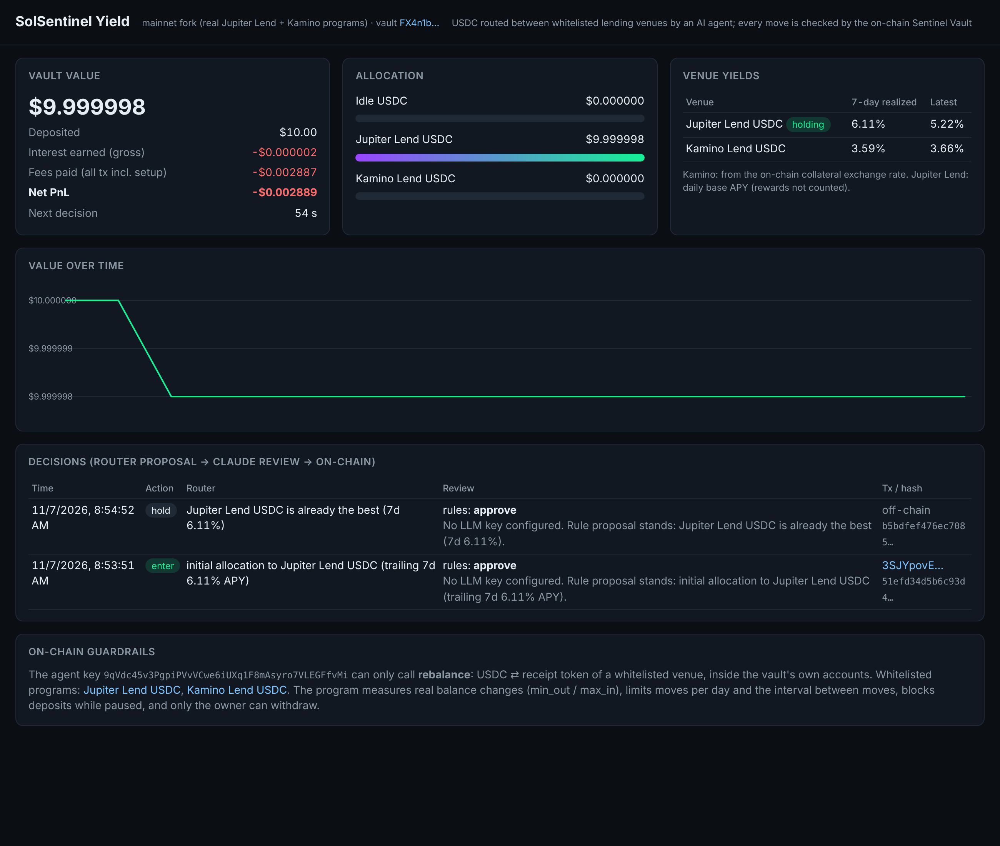

# SolSentinel

**An AI agent that earns stablecoin yield on its own, inside a Solana vault that only lets it move your USDC between whitelisted lending pools.**

## SolSentinel Yield (main submission)

- **What it does:** USDC sits in the Sentinel Vault, a PDA. The agent routes it between **Jupiter Lend Earn** and **Kamino Lend**, holding the venue with the best trailing 7-day realized yield. It switches only when 14 days of extra yield pays for both transactions.
- **Claude:** reviews each proposal and can approve, hold, or exit to idle USDC.
- **What the vault enforces:**
  - only `rebalance`, and only into a whitelisted (program, receipt mint) pair;
  - funds stay in the vault's own accounts;
  - measured `max_in` / `min_out`;
  - moves per day and a minimum interval between moves;
  - pause blocks deposits, while withdrawals to USDC always work;
  - only the owner can withdraw;
  - every account can be closed for a full rent refund.



**Backtest of these exact two venues, 2026-02-27 → 2026-11-07, every fee counted** (`research/yield/router2.py`, output in `router2.out`):

| Vault | Router net APY | Jupiter Lend only | Kamino only |
|---|---|---|---|
| $10 | 4.10% | 3.72% | 4.20% |
| $100 | 4.47% | 3.86% | 4.35% |
| $1000 | 4.51% | 3.87% | 4.36% |

All 200 rolling 30-day windows were positive. At $10 the fixed fees eat most of the routing edge.

```bash
npm run build:programs
npm run validator:fork                 # mainnet fork: real Jupiter Lend, Jupiter Liquidity, Kamino Lend programs + USDC reserves
npm run test:fork                      # 11 tests: deposits/withdrawals through the vault into the real protocols + attack cases
scripts/restart-fork.sh && npm run yield:deploy -- --mode fork
npm run yield -- --mode fork --decide-minutes 1   # dashboard on http://localhost:8788
```

**Mainnet on a $10 budget: direct mode.** Deploying the vault program needs about 1.9 SOL of rent, so for a 10 USDC run the agent wallet holds the funds itself. Every guardrail still runs before each send: a program whitelist (Jupiter Lend, Kamino, ATA, Memo), a simulation of the exact transaction checked against `max_in`/`min_out`, moves per day and the minimum interval between moves. The decision hash goes in an SPL Memo in the same transaction. A full round trip on the fork (Jupiter → Kamino → idle, then closing the receipt accounts) returned 10 USDC → 9.999999 USDC. Fees were 27,000 lamports for 5 transactions, and all rent came back.

**Live on mainnet with real money (2026-11-07 16:31 UTC):** the agent deposited 8.945331 USDC into Jupiter Lend ([tx 3aLHFor…TRu1UuDVr](https://solscan.io/tx/3aLHForFJLv1rxt2MgdSztgqLNh9coqvtDeBuyEPvxGptb4xUs1tiscsLbSBKMmQm9bcYn3FD8AFRWzTRu1UuDVr)), with the decision hash in the same transaction's Memo. Demo video: https://youtu.be/MP8hbujpc8g. Full write-up: [SUBMISSION.md](SUBMISSION.md).

```bash
npx tsx agent/src/yield-direct-setup.ts mainnet            # records the starting USDC/SOL of the agent wallet
npm run yield -- --mode mainnet --direct --once           # one decision; run it on a schedule (positions earn while nothing runs)
npx tsx agent/src/yield-direct-exit.ts --mode mainnet --payout <your wallet>   # unwind, close accounts, pay out
```

Files: `programs/sentinel_vault` (`rebalance`, `init_yield`, `close_*`), `agent/src/{router,yield-agent,yield-chain,yield-brain,jlend,kamino,yield-deploy}.ts`, `agent/test/yield-fork.test.ts`, `dashboard/yield.html`.

---

## Earlier component: guarded SOL/USDC trading agent

**An autonomous AI trading agent that cannot rug you, because its risk limits live on-chain.**

SolSentinel trades SOL/USDC on its own. A fast rule engine reacts to on-chain prices within one RPC round trip, and Claude supervises it every few minutes. The new part is the **Sentinel Vault**, an Anchor program that holds the funds. The agent key can trade through the vault but can never withdraw. Every swap is checked against the owner's policy: per-trade cap, cooldown, trades per day, slippage floor, a daily-loss circuit breaker and a whitelisted swap program. The vault checks fills by reading its own token balances before and after the CPI, so the agent cannot misreport them. Every AI decision is hashed and logged on-chain.

> If the LLM gets prompt-injected ("move all funds to 8xAttacker…"), the worst it can do is one in-policy $5 trade.

Built for the MLH Solana Hackathon (Nov 2026). Tracks: **AI**, **DeFi**, **Beginner**, Overall.

---

## Why Solana

| Solana property | How SolSentinel uses it |
|---|---|
| ~400 ms slots, cheap txs | Price ticks come straight from the Orca SOL/USDC Whirlpool account. A signal becomes a signed transaction in about 20 ms, confirmed in about 200–350 ms (measured, see below). |
| Composability (CPI) | The vault CPIs into one whitelisted swap program (Jupiter on mainnet), signing as a PDA. The trade and the risk check happen in the same transaction. |
| On-chain ownership | Funds sit in PDA-owned token accounts. The owner can pause, retune or withdraw. The agent key cannot withdraw. |
| Transparent state | Pyth oracle and pool reads, the decision log (`log_decision` with a sha256 of the reasoning), policy counters and realized PnL are all public. |

## Architecture

```mermaid
flowchart LR
  subgraph Mainnet data
    ORCA[Orca SOL/USDC Whirlpool<br/>sqrt_price, every slot]
    PYTH[Pyth SOL/USD<br/>PriceUpdateV2]
  end
  subgraph Agent (TypeScript)
    FEED[Feed: 1 RPC call / 500 ms] --> FAST[Fast brain<br/>precomputed levels vs tick]
    BARS[1m bars] --> SLOW[Slow brain: Claude<br/>regime + bounded param patch]
    SLOW -->|regime, params| FAST
    FAST -->|signal| RISK[Off-chain risk mirror]
  end
  ORCA --> FEED
  PYTH --> FEED
  FEED --> BARS
  RISK -->|log_decision + swap, one tx| VAULT
  subgraph On-chain guard
    VAULT[Sentinel Vault - Anchor<br/>policy checks, balance-delta accounting,<br/>daily-loss halt, decision log]
    VAULT -->|CPI, PDA signs| SWAP[Jupiter mainnet / mock AMM devnet]
  end
  OWNER((Owner)) -->|pause, set_policy, withdraw| VAULT
```

**Dual-speed design.** An LLM call takes seconds, so the LLM never sits in the order path.
- **Slow brain (Claude, every 10 min):** reads a compact snapshot (returns, ATR, efficiency ratio, EMA state, Bollinger z, recent trades) and returns strict JSON: regime (`trend` / `range` / `halt`), an optional parameter patch clamped to safe bounds, and a pause flag. It uses structured outputs (`messages.parse` + Zod). With no API key, or on any error, it falls back to the rule-based regime.
- **Fast brain (every tick):** once per closed 1-minute bar it precomputes trigger levels (breakout high + k·ATR, or Bollinger lower band). On each tick it only compares numbers, then fires.
  - *Trend:* breakout long, 2·ATR take-profit, 1·ATR trailing stop.
  - *Range:* mean-reversion long below −2σ, exit at the mean, stop at −3σ.
  - Every position has a 30-minute time stop. Entries need a target move of at least 3× the round-trip cost.
- **Guards:** a Pyth vs. Orca deviation check (>0.5% blocks entries), an off-chain mirror of the policy (to skip doomed transactions), and the on-chain vault as the final authority.

## Sentinel Vault (Anchor program)

`programs/sentinel_vault/src/lib.rs`

| Instruction | Who | What |
|---|---|---|
| `initialize_vault(agent, swap_program, policy)` | owner | Creates the vault PDA and its USDC/SOL token accounts. |
| `swap(side, max_in, min_out, cpi_data)` | agent | Checks policy → CPI to the whitelisted program (PDA signs) → reads balance deltas → enforces `spent ≤ max_in` and `received ≥ min_out` → books cost basis and realized PnL → halts buys for the day when realized loss ≥ limit. **Sells are allowed while paused**, so the kill switch can flatten risk instead of trapping it. |
| `log_decision(regime, action, price, reason_hash)` | agent | Appends an AI decision (sha256 of the full reasoning JSON, which the agent keeps in `data/journal-*.jsonl`) and emits an event. Anyone can re-hash and verify it. |
| `set_paused`, `set_policy`, `set_agent`, `withdraw` | owner | Kill switch, retune, rotate the agent key, withdraw. |

`programs/mock_swap` is a constant-price AMM used **only on localnet/devnet**, because Jupiter has no devnet liquidity. The agent posts the live mainnet price to it before each fill, and it charges a 0.1% fee.

### Tests (all passing)

`agent/test/vault.test.ts` runs against `solana-test-validator` with both programs loaded:

```
ok 1 - vault starts with the 10 USDC deposit
ok 2 - agent can buy within the cap; fill measured from real balances
ok 3 - second buy inside cooldown is rejected
ok 4 - buy above the per-trade cap is rejected
ok 5 - slippage guard: min_out above what the pool pays is rejected
ok 6 - a non-agent key cannot trade
ok 7 - agent key cannot withdraw funds
ok 8 - log_decision stores the reasoning hash
ok 9 - owner pause blocks buys but still allows selling to flatten
ok 10 - after unpausing, the daily-loss halt still blocks new buys
ok 11 - owner can withdraw
```

### "AI got prompt-injected" demo (`npm run demo:guard -- local`)

```
▶ 1. Withdraw the whole vault to an attacker account (agent key)
  ✋ blocked on-chain: ConstraintSeeds
▶ 2. Market-buy with the full balance (above the $5 per-trade cap)
  ✋ blocked on-chain: TradeTooLarge: Trade exceeds per-trade cap
▶ 3. Route the 'swap' through a different program (token transfer to attacker)
  ✋ blocked on-chain: SwapProgramNotAllowed
▶ 4. Accept a terrible fill (min_out far above the pool quote)
  ✋ blocked on-chain: Slippage
▶ 5. Two buys back to back (cooldown)
  first $1 buy is within policy and goes through
  ✋ blocked on-chain: Cooldown
```

## Measured latency (local validator, smoke profile)

| Step | Time |
|---|---|
| Tick received → signed tx sent (decision log + price post + guarded swap in **one** tx) | 18–22 ms |
| Sent → confirmed (`confirmed` commitment) | 196–335 ms |
| Paper mode: tick → Jupiter mainnet quote filled | 305–382 ms |

## Backtest (honest numbers)

Last 7 days of SOL/USDT 1-minute bars. Every bar is replayed as 4 ticks through the **same** `onTick()` the live agent uses. When a bar touches both the stop and the target, the stop is assumed first. Costs are 0.1% per side. $10 start, $5 per trade.

| Run | Trades | Return | Max DD | Buy & hold |
|---|---|---|---|---|
| Default params, full 7 days | 8 | **−0.97%** | 1.20% | −5.42% |
| Default params, last 2 days (out of sample) | 5 | **−0.09%** | 0.51% | −6.10% |
| Params tuned on first 5 days, tested on last 2 | 13 | −1.31% | 1.67% | −6.10% |

The strategy did **not** make money this week. It lost far less than holding SOL through a −5–6% move. The grid-tuned parameters did *worse* out of sample, which is why the agent ships with the defaults. The point of the project is not a magic strategy. It is a system where an autonomous strategy, good or bad, can be trusted with funds. Reproduce with `npm run backtest` and `npm run walkforward`.

## Run it

Prerequisites: Node 22+, Rust, Solana CLI (Agave 4.x), Anchor CLI 1.2.

```bash
npm install
npm run build:programs           # anchor build, copies IDL + types into agent/idl
npm test                         # needs `npm run validator` in another shell

# local chain, full on-chain path
npm run validator                # shell 1
npm run deploy:local             # mints demo USDC/SOL, mock pool, vault funded with 10 USDC
npm run agent -- --mode local --profile demo     # dashboard on http://localhost:8787
npm run demo:guard -- local

# paper trading on mainnet prices with real Jupiter quotes (no wallet needed)
npm run agent -- --mode paper

# devnet (fund ~/.config/solana/id.json with ~5 devnet SOL first)
npm run deploy:devnet && npm run agent -- --mode devnet --profile demo
```

Environment:
- `ANTHROPIC_API_KEY`: enables the Claude slow brain (model `claude-opus-5-5`, `LLM_MODEL` to override). Without it the agent uses the rule regime.
- `PRICE_RPC`: mainnet RPC for price reads (default public endpoint; a private RPC avoids 429s).
- `RPC_URL`: execution cluster override.
- `AGENT_KEYPAIR`, `OWNER_KEYPAIR`: keypair paths.
- `PRIORITY_MICROLAMPORTS`: compute-unit price.
- `POLL_MS`: price poll interval (default 500).

Profiles:
- `prod`: the backtested parameters.
- `demo`: looser filters so a short demo shows trades.
- `smoke`: enters on almost any uptick, to exercise the pipeline.

### Mainnet

`--mode mainnet` routes through Jupiter's `swap-instructions` with the vault PDA as the user, wrapped in `sentinel_vault::swap`. This swap path of the earlier trading agent is implemented but was not run with real funds. (The yield agent above is the one live on mainnet.) Deploy the vault with `swap_program = JUP6Lkb…`, deposit a small amount (e.g. 10 USDC) and watch the first trade.

## Repo layout

```
programs/sentinel_vault   Anchor program: the on-chain guard
programs/mock_swap        devnet/localnet stand-in for Jupiter
agent/src/strategy.ts     dual-speed strategy (pure, shared by backtest and live)
agent/src/brain.ts        Claude slow brain (structured outputs, bounded patches)
agent/src/feed.ts         Orca + Pyth on-chain price feed, 1m bar builder
agent/src/chain.ts        vault client, timed sends, demo deployment
agent/src/jupiter.ts      Jupiter quotes (paper) and vault-wrapped swaps (mainnet)
agent/src/main.ts         the agent + dashboard server
agent/src/backtest.ts     tick-replay backtester; tune.ts walk-forward
agent/src/guard-demo.ts   prompt-injection attack demo
dashboard/index.html      live dashboard
```

## Limits and next steps

- Long-only spot. Shorts would need a perps venue (e.g. Drift) behind the same vault pattern.
- The devnet/local swap venue is a mock AMM priced from live mainnet data. Only the mainnet path hits real liquidity.
- The daily-loss breaker counts realized PnL only. An on-chain Pyth read inside `swap` could add an unrealized-loss check.
- Next: Jito bundles for MEV protection, per-strategy sub-vaults, and an owner UI (Blink) to pause or withdraw from any wallet.
