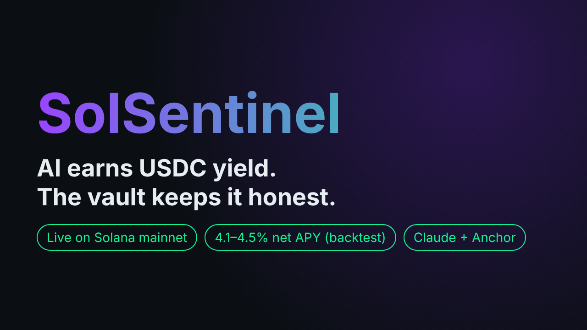
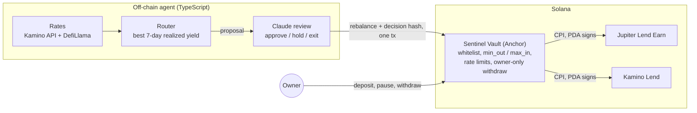
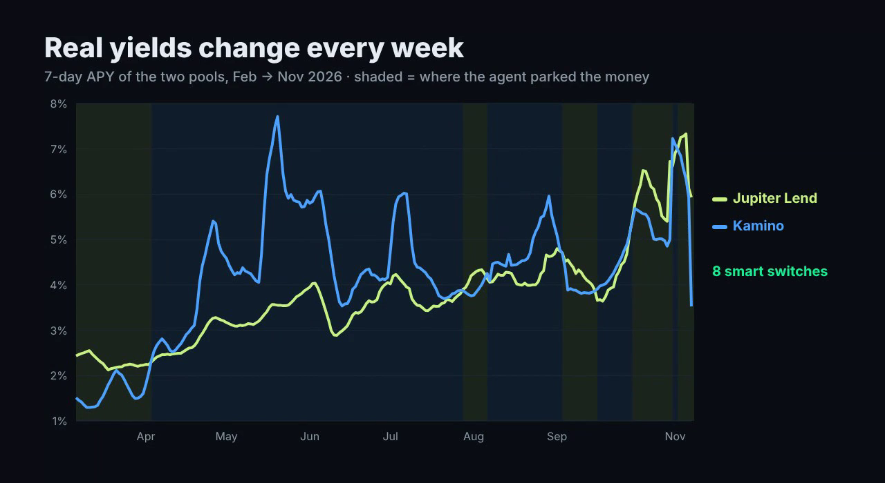
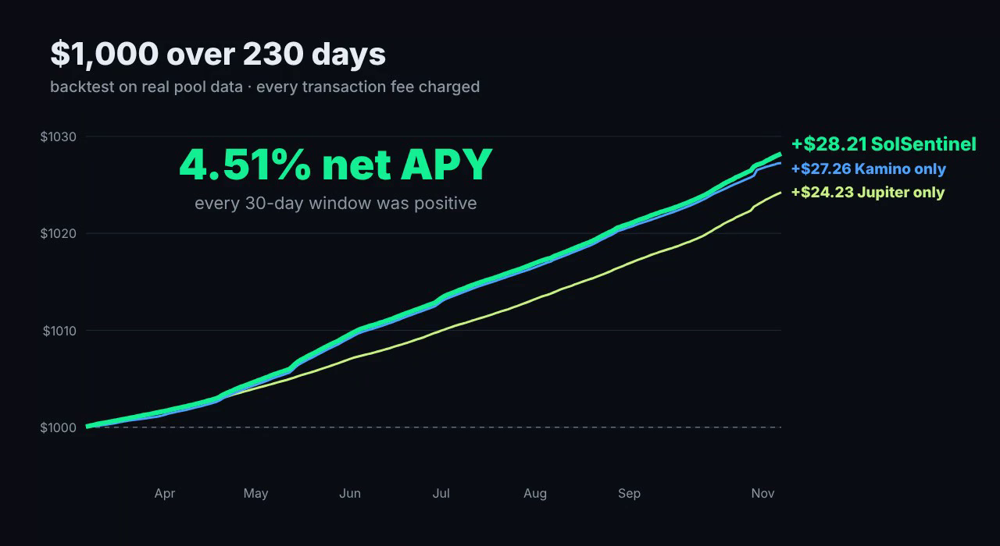

<div align="center">



# SolSentinel

**An autonomous AI agent that earns stablecoin yield on Solana, inside a vault that only lets it move USDC between whitelisted lending pools.**

[](https://solscan.io/tx/3aLHForFJLv1rxt2MgdSztgqLNh9coqvtDeBuyEPvxGptb4xUs1tiscsLbSBKMmQm9bcYn3FD8AFRWzTRu1UuDVr)
[](programs/sentinel_vault/src/lib.rs)
[](agent/src)
[](agent/src/yield-brain.ts)
[](agent/test/yield-fork.test.ts)
[](https://www.mlh.com/events/solana-hackathon)

[**Demo video**](https://youtu.be/MP8hbujpc8g) · [**Live mainnet tx**](https://solscan.io/tx/3aLHForFJLv1rxt2MgdSztgqLNh9coqvtDeBuyEPvxGptb4xUs1tiscsLbSBKMmQm9bcYn3FD8AFRWzTRu1UuDVr) · [**Write-up**](SUBMISSION.md) · [**Quick start**](#quick-start)

</div>

---

## Table of contents

- [Why](#why)
- [Highlights](#highlights)
- [How it works](#how-it-works)
- [Results](#results)
- [Security model](#security-model)
- [Quick start](#quick-start)
- [Running on mainnet](#running-on-mainnet)
- [Project structure](#project-structure)
- [Roadmap](#roadmap)
- [Disclaimer](#disclaimer)

## Why

Idle USDC earns nothing, and lending yields on Solana move every week. An AI agent can chase the best pool for you, but handing an AI your wallet is dangerous: one prompt injection and it can drain you.

SolSentinel gives the AI **exactly one power: move USDC between whitelisted lending pools.** A Solana program enforces that limit on-chain, so even a fully compromised agent cannot send funds anywhere else.

## Highlights

- 🛡️ **On-chain guardrails.** The Sentinel Vault (Anchor) only allows CPIs into whitelisted lending programs. It measures balances before and after every move, enforces `min_out` / `max_in` and rate limits, and lets only the owner withdraw.
- 🧠 **Router + Claude review.** A deterministic router picks the pool with the best trailing 7-day *realized* yield and switches only when 14 days of extra yield pays for the transactions. Claude reviews each proposal and can approve it, hold, or pull back to idle USDC.
- 🔗 **Verifiable decisions.** Every decision is hashed (sha256 of inputs, proposal and review) and written on-chain in the same transaction as the move.
- 💰 **Profitable after every cost.** Backtested on 230 days of real pool data with every fee charged: **4.51% net APY** on $1,000. Every 30-day window was positive.
- 🧪 **Tested against the real protocols.** 11 tests run on a local mainnet fork that clones the production Jupiter Lend and Kamino programs.
- 🚀 **Live on mainnet** with real money since 2026-11-07.

## How it works



1. **Read rates.** The agent loads each pool's realized yield history: Kamino's collateral exchange rate and Jupiter Lend's daily APY.
2. **Propose.** The router stays in the current pool unless another pool's 7-day yield edge, earned over 14 days, beats the cost of two transactions.
3. **Review.** Claude checks the proposal against pool health, such as utilization near 100% or broken data, using structured outputs. It can never pick a pool the router didn't propose. Without an API key, or if the call fails, the rule result stands.
4. **Execute.** One transaction calls the vault's `rebalance`. The vault CPIs into the lending program, checks the measured token deltas, and records the decision hash.

## Results

### Real pool yields, Feb → Nov 2026



The two pools trade places often. The shading shows where the router parked the money; it switched 8 times in 230 days.

### $1,000 over 230 days, every fee counted



| Vault size | **SolSentinel router** | Jupiter Lend only | Kamino only |
|---:|---:|---:|---:|
| $10 | **4.10%** | 3.72% | 4.20% |
| $100 | **4.47%** | 3.86% | 4.35% |
| $1,000 | **4.51%** | 3.87% | 4.36% |

Net APY from 2026-02-27 to 2026-11-07. The backtest charges setup, every switch (2 transactions), closing transactions and Kamino rounding. Each decision uses only data up to the previous day. At $10, fixed fees eat most of the routing edge; from $100 up, the router beats both pools. To reproduce: `cd research/yield && python3 router2.py`.

### Live on mainnet

| | |
|---|---|
| Deposit | 8.945331 USDC into Jupiter Lend, 2026-11-07 16:31 UTC |
| Transaction | [`3aLHFor…TRu1UuDVr`](https://solscan.io/tx/3aLHForFJLv1rxt2MgdSztgqLNh9coqvtDeBuyEPvxGptb4xUs1tiscsLbSBKMmQm9bcYn3FD8AFRWzTRu1UuDVr), with the decision hash in an SPL Memo in the same tx |
| Strategy cost | 2 transaction fees (deposit + exit), about $0.001 |
| After 20.5 h | +$0.00099 interest, about break-even after both fees |

The mainnet run uses **direct mode** to stay under a $10 budget, because deploying the vault program costs about 1.9 SOL of rent. The agent wallet holds the funds, and the same guardrails run as a simulation of each transaction before it is sent.

## Security model

What a fully compromised agent key **cannot** do. Each case is covered by a test on the mainnet fork.

| Attack | Result |
|---|---|
| Send USDC to an attacker | ❌ blocked: only the owner can withdraw |
| Call an unknown program | ❌ blocked: `rebalance` only CPIs into whitelisted programs |
| Swap into the wrong token | ❌ blocked: the receipt mint must match the venue |
| Accept a bad price | ❌ blocked: measured `min_out` / `max_in` |
| Spam moves to burn fees | ❌ blocked: minimum interval and moves-per-day cap |
| Deposit while paused | ❌ blocked: pause stops deposits, while withdrawals still work |

```text
$ npm run test:fork
ok 1  - agent deposits 10 USDC into Jupiter Lend; vault receives jlUSDC
ok 2  - min_out above what the lending program gives is rejected (Slippage)
ok 3  - lending program not on the whitelist is rejected
ok 4  - receipt account of the wrong mint is rejected
ok 5  - unknown venue index is rejected
ok 6  - deposits blocked while paused; withdrawals back to USDC still allowed
ok 7  - rate limit: interval between moves is enforced
ok 8  - rate limit: moves per day capped (4)
ok 9  - agent cannot withdraw receipt tokens out of the vault; owner can
ok 10 - second venue: Kamino Lend USDC reserve, deposit then redeem through the vault
ok 11 - owner unwinds everything and gets all rent back
```

## Quick start

**Prerequisites:** Node 22+, Rust, Solana CLI (Agave 4.x), Anchor CLI 1.2.

```bash
git clone https://github.com/k66inthesky/SolSentinel.git && cd SolSentinel
npm install
npm run build:programs

# 1. Start a local mainnet fork with the real Jupiter Lend and Kamino programs
npm run validator:fork

# 2. In another shell, run the 11 vault tests against them
npm run test:fork

# 3. Deploy a vault on the fork and start the agent with its dashboard
scripts/restart-fork.sh && npm run yield:deploy -- --mode fork
npm run yield -- --mode fork --decide-minutes 1    # http://localhost:8788
```

| Variable | Purpose |
|---|---|
| `ANTHROPIC_API_KEY` | Turns on the Claude review. Without it, the router's rule result is used. |
| `RPC_URL` | Cluster override (default: `127.0.0.1:8899` on the fork, the public RPC on mainnet). |
| `AGENT_KEYPAIR` | Agent keypair path (default `~/.config/solana/agent.json`). |

## Running on mainnet

```bash
npx tsx agent/src/yield-direct-setup.ts mainnet                                # record starting balances
npm run yield -- --mode mainnet --direct --once                                # one decision; run it on a schedule
npx tsx agent/src/yield-direct-exit.ts --mode mainnet --payout <your wallet>   # unwind and pay out in one tx
```

Positions keep earning while nothing runs, so running `--once` on a schedule is enough. The exit redeems the position, closes every account to recover its rent, and returns all USDC and SOL in one transaction.

## Project structure

```text
programs/sentinel_vault/      Anchor program: rebalance, init_yield, pause, withdraw, close_*
agent/src/router.ts           yield router (trailing realized yield, switch-cost check)
agent/src/yield-brain.ts      Claude review with structured outputs and a rule fallback
agent/src/yield-chain.ts      vault client, valuation by simulated exit, guarded sends
agent/src/jlend.ts            Jupiter Lend Earn instructions and state
agent/src/kamino.ts           Kamino Lend instructions built from the IDL
agent/src/yield-agent.ts      agent loop and dashboard server
agent/test/yield-fork.test.ts mainnet-fork test suite
dashboard/yield.html          live dashboard
research/yield/               backtest data and scripts
docs/trading-agent.md         earlier component: guarded SOL/USDC trading agent
```

## Roadmap

- [x] Vault with whitelisted CPI, measured deltas and rate limits
- [x] Jupiter Lend Earn and Kamino Lend integrations
- [x] Mainnet-fork test suite against the real programs
- [x] Live mainnet run
- [ ] Deploy the vault program on mainnet
- [ ] More venues: Drift, marginfi
- [ ] On-chain utilization and withdrawal-liquidity checks
- [ ] Solana Blink so the owner can pause or withdraw from any wallet

## Disclaimer

SolSentinel is a hackathon project built for the [MLH Solana Hackathon](https://www.mlh.com/events/solana-hackathon) (Nov 2026). It is unaudited: don't deposit funds you can't afford to lose. Backtest results don't guarantee future returns, and nothing here is financial advice.
